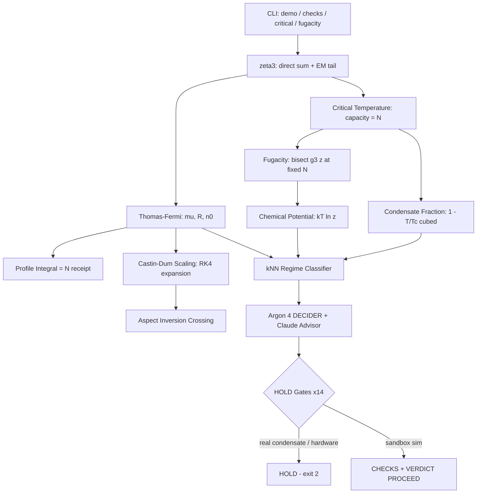
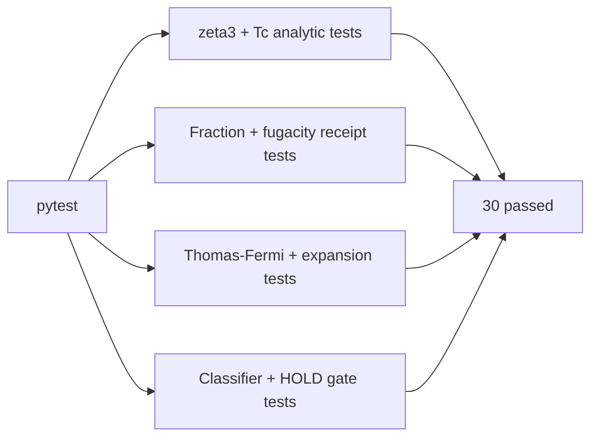
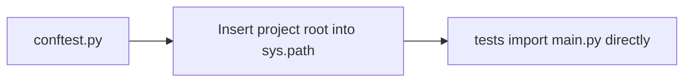
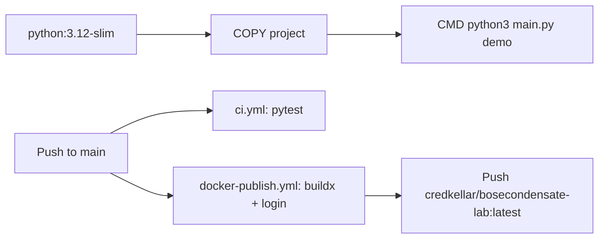

# BoseCondensate-Lab 🧊⚛️

**Bose-Einstein Condensate Lab — Critical Temperature, Condensate Fraction & the Thomas-Fermi Profile** — by Darion Kellar

BoseCondensate-Lab is an **educational Bose-Einstein condensate lab** in ONE pure-Python file. It builds the textbook theory of a trapped Bose gas from the ground up, with every headline number graded against the closed form it comes from: **ζ(3) summed from scratch** (direct terms + an Euler–Maclaurin tail) sets the excited-state capacity and therefore the **critical temperature Tc = 209.51 nK** for the labelled set (⁸⁷Rb-like mass, N = 100,000 atoms, 100 Hz geometric-mean trap) — with the receipt printed: at Tc, N_ex(z = 1) comes back at exactly 100,000.0 atoms. Below Tc the **condensate fraction** follows 1 − (T/Tc)³ — exactly **0.875 at T/Tc = 0.5**, exactly zero at and above Tc. Above Tc the **fugacity** is solved by bisection against the Bose function g₃(z), itself summed term by term: z = 0.997803 at T/Tc = 1.001 with μ = −0.4612 nK, reaching 0⁻ exactly at Tc, and the solved z reproduces N to better than one part in 10⁶ at every tabulated temperature. Turn interactions on and the ground state flattens into the **Thomas-Fermi parabola**: μ_TF = 17.6125 ħω̄ = 84.53 nK, R_TF = 6.397 µm by two independent routes, n(0) = 2.2797×10¹⁴ /cm³, and the profile integrates back to exactly 100,000.0 atoms — while the lab prints the **interaction ratio 11.7417** against the ideal-gas zero-point scale, so the size of the Thomas-Fermi step is on the page, not under it. Release the trap and the **Castin–Dum scaling equations**, integrated with written-out RK4, take the cloud from a cigar (aspect 10.0) through the inversion at **9.09 ms** to a pancake (0.4078 at 30 ms) — computed, never quoted.

Honest scope, stated up front: every parameter is a **labelled teaching number**. No gas was cooled, no condensate was made, no atom was imaged. A computed Tc is a property of these equations at these inputs — not a measurement, not a cooling record, not a device claim. Every real-condensate / laser-cooling / atom-laser / sensor / record use sits behind a permanent HOLD gate (14 total). 🔒

[](https://github.com/kimanicollier44-cmyk/BoseCondensate-Lab/actions/workflows/ci.yml)
[](https://github.com/kimanicollier44-cmyk/BoseCondensate-Lab/actions/workflows/docker-publish.yml)

> ℹ️ These are the **live** workflow badges for this repo. They activate as soon as the `ci.yml` and `docker-publish.yml` files from the paste pack are pasted into `.github/workflows/` — until then they have nothing to report yet.

## 🧰 Tech Stack Badges & Full Architecture Tech Stack

### 💻 Core Programming Languages & Core Systems


- 🐍 Python 3.12, pure standard library (`math`, `hashlib`, `json`, `sys`) — zero dependencies, zero network, deterministic (double-run byte-identical)
- 🧊 Critical-temperature core from scratch: ζ(3) by direct summation plus an Euler–Maclaurin tail (agrees with the reference to 10 decimal places), Tc from N = ζ(3)·(k_BT_c/(ħω̄))³, and the capacity receipt N_ex(z = 1, Tc) = N asserted in CHECKS
- 🎯 Fugacity core: the Bose function g₃(z) = Σ zᵏ/k³ summed term by term, z(T) solved by bracketed bisection at fixed N, μ = k_BT ln z printed in nK — the solved z reproduces the labelled N at every tabulated temperature
- 🍮 Thomas-Fermi core: μ_TF = (ħω̄/2)·(15Na/a_ho)^(2/5), R from √(2μ/(mω̄²)) cross-checked against a_ho·(15Na/a_ho)^(1/5), n(0) = μ/g with g = 4πħ²a/m, and the inverted-parabola profile integrated back to N as a check, not an assumption
- 🚀 Expansion core: the Castin–Dum scaling equations for the released TF cloud integrated with written-out RK4 — the aspect-ratio inversion crossing is read off the integration, never quoted
- 🧠 TinyML kNN regime classifier (from scratch, stdlib, distance-weighted): condensed / strongly-interacting / near-critical / thermal from (T/Tc, N₀/N, μ_TF/((3/2)ħω̄)), labels from the lab's own policy
- 🪑 Council seats: Gemini Argon 4 DECIDER (names-only, tighten-only) + Muse advisor (never overrides HOLD) + Google Flow plan-only (rendered = False, live = 0)

### ⛓️ Web3 & Infrastructure

- 🚫 **Not applicable — honestly.** No blockchain, no Web3, no tokens: the "infrastructure" in this lab is one offline file holding a Bose function, a fraction curve, and a scaling integrator. Real vacuum, laser, and trap plant are permanent HOLD gates, not features. No fake badges here.

### ⚙️ Platform Support & Hardware Architecture


- 🖥️ Pure Python — runs anywhere Python 3.12+ runs (Linux, macOS, Windows), plus the `python:3.12-slim` Docker image
- 🔒 No hardware is controlled, ever: real lasers, vacuum chambers, magnetic traps, and cameras are permanent HOLD gates (see the gate table below)

### ⚡ Low-Level Infrastructure & Performance

- 🚫 **No low-level code — honestly.** No C, no C++, no GPU, no compiled extensions: this is one interpreted Python file on purpose, so every sum can be read, checked, and diffed. Performance here means honest algorithms — a 20,000-term ζ(3) summation with an analytic tail, a 200-step bracketed bisection for z(T), and a 15,000-step RK4 integration of the scaling equations — all deterministic and byte-identical between runs.

### 🛠️ DevOps & Build Tools


- 🐳 Docker (`python:3.12-slim`), GitHub Actions CI + Docker Publish (delivered in the paste pack)
- 🎯 Target image: `credkellar/bosecondensate-lab:latest`
- 🧪 Tests: `pytest` (30 tests) + the built-in CHECKS suite (52 checks) in `main.py`

### ☁️ Cloud Providers

- 🚫 **None — honestly.** No cloud provider is used or needed: the lab runs fully offline on your own machine or in a local Docker container. Docker Hub appears only as the registry the publish workflow pushes the image to.

## What this does?

1. 🔢 **ζ(3) from scratch** — the excited states of a harmonically trapped gas can hold at most ζ(3)·(k_BT/(ħω̄))³ atoms. The lab sums ζ(3) directly (20,000 terms) plus an Euler–Maclaurin tail and prints **1.2020569031596** against the reference 1.2020569031595942 — agreement to 10 decimal places, computed, not imported.
2. 🌡️ **Critical temperature** — setting the capacity equal to N gives Tc = (ħω̄/k_B)·(N/ζ(3))^(1/3) = **209.51 nK** for the labelled set. The receipt is printed with it: feeding Tc back through N_ex(z = 1, T) returns exactly **100,000.0 atoms**.
3. 📏 **Tc scaling laws, asserted** — Tc ∝ N^(1/3)·ω̄: eight times the atoms doubles Tc (×2.0000), 27× triples it, and doubling the trap frequency doubles it again — each ratio checked against its law in CHECKS, not just displayed.
4. 📉 **Condensate fraction** — below Tc the excited states saturate and the overflow piles into the ground state: N₀/N = 1 − (T/Tc)³. The table runs 1.0000 at T = 0 through **0.8750 at T/Tc = 0.5** (exact) and 0.2710 at 0.9, to exactly zero at Tc — and stays exactly zero above it.
5. 🎯 **Fugacity above Tc** — with no condensate, z < 1 does the bookkeeping: g₃(z) is summed term by term and z(T) is bisected at fixed N. At T/Tc = 1.001, z = 0.997803 and μ = **−0.4612 nK**; by T/Tc = 3, z = 0.044272 and μ = −1959.34 nK. Every solved z is fed back through N_ex and reproduces N.
6. 🧲 **μ → 0⁻, never through zero** — the chemical potential approaches 0 from below as T → Tc⁺ and is pinned at exactly 0 (z = 1) below Tc in the ideal-gas model. The sign discipline is asserted in CHECKS: μ < 0 at every tabulated T > Tc.
7. 🍮 **Thomas-Fermi profile** — with the labelled scattering length a = 100 a₀ switched on, repulsion flattens the ground state into n(r) = n(0)(1 − r²/R²): a_ho = 1.0779 µm, Na/a_ho = 490.9, **μ_TF = 17.6125 ħω̄ = 84.53 nK**, **R_TF = 6.397 µm**, n(0) = 2.2797×10¹⁴ /cm³.
8. ⚖️ **The TF step, priced** — Thomas-Fermi drops the kinetic energy outright. The lab prints the comparison openly: μ_TF against the ideal-gas zero-point scale (3/2)ħω̄ gives an **interaction ratio of 11.7417** — deep in the regime where the approximation is self-consistent, and the number is shown either way. The profile then integrates back to exactly 100,000.0 atoms.
9. 📐 **TF scaling laws, asserted** — μ_TF ∝ N^(2/5) and R ∝ N^(1/5): at N ×8 the sweep reads μ ×2.2974 and R ×1.5157, at N ×64 μ ×5.2780 and R ×2.2974 — each against its law in CHECKS. The radius is also computed by two independent routes (√(2μ/(mω̄²)) and a_ho·(15Na/a_ho)^(1/5)) and the routes are required to agree.
10. 🚀 **Release + expansion, integrated** — for a labelled anisotropic trap (2π × (200, 200, 20) Hz) the cloud starts as a cigar with R_z/R_x = **10.0**; the Castin–Dum scaling equations, integrated by RK4, carry the aspect ratio through **1 at t = 9.09 ms** to **0.4078 at 30 ms** — the famous aspect-ratio inversion as an integration result, with the crossing read off the computed curve.
11. 🏷️ **Regime classifier + seats + checks** — a from-scratch distance-weighted kNN labels regimes condensed / strongly-interacting / near-critical / thermal from the lab's own policy (the headline ⁸⁷Rb-like set at half Tc: strongly-interacting, because its interaction ratio is 11.74), with Argon 4 DECIDER (sha256 trace), Muse advisor, Google Flow plan-only, and a built-in CHECKS suite (52 checks).

## 🗺️ How it works — diagram per script

### `main.py` — the whole lab



### `tests/test_main.py` — verification



### `conftest.py` — test path setup



### `Dockerfile` + CI flow — container & publish



## Why is this cool?

1. 🔢 ζ(3) — the number the whole phenomenon hangs on — is **summed in the open**, 20,000 terms plus an analytic tail, and lands on the reference value to 10 decimal places.
2. 🌡️ Tc comes with a **receipt**: the same code that derives 209.51 nK feeds it back through the capacity formula and returns exactly 100,000.0 atoms.
3. 🎯 The fraction at half Tc is **exactly 0.875** — not 0.87, not ≈0.88 — because the curve is the closed form evaluated, not a simulation histogram.
4. 🧲 The fugacity solve shows its work twice: bisection brackets z, and the answer is then required to **reproduce N** through the forward formula before anyone believes it.
5. ⚖️ The Thomas-Fermi approximation **prices itself**: the interaction ratio 11.7417 is printed next to μ_TF, so you can see exactly how hard the kinetic energy was pushed aside.
6. 🍮 The TF profile **integrates back to N exactly** — the parabola, the radius, and the peak density are three views of one consistent object, and CHECKS make them prove it.
7. 🚀 The aspect-ratio inversion is **integrated, not quoted**: RK4 on the Castin–Dum equations finds the crossing at 9.09 ms from the dynamics, the way the experiments see it.
8. 📐 Every scaling law (N^(1/3), N^(2/5), N^(1/5), linear in ω̄) is **asserted numerically** on sweeps — the exponents are tested, not typeset.
9. 🧊 The fences are physical, not decorative: the fraction is *exactly* zero above Tc and μ *never* crosses zero — the code enforces the phase transition's bookkeeping discipline.
10. 🎯 Deterministic end to end: run it twice, get byte-identical output — a condensate you can diff.

## What problems this solves?

1. ❌ **Problem:** BEC explainers quote Tc formulas with ζ(3) as a magic constant. ✅ **Solution:** ζ(3) is summed from scratch with its tail correction shown, and Tc is derived from the capacity statement in the same file.
2. ❌ **Problem:** "Condensate fraction" is usually shown as a cartoon curve. ✅ **Solution:** The exact 1 − (T/Tc)³ table is printed with the 0.875-at-half-Tc anchor asserted to the last digit.
3. ❌ **Problem:** Fugacity and chemical potential above Tc are hand-waved as "μ becomes negative". ✅ **Solution:** z(T) is actually solved by bisection, μ(T) is tabulated in nK, and each solution must reproduce N through the forward formula.
4. ❌ **Problem:** Thomas-Fermi results are quoted without saying what was thrown away. ✅ **Solution:** The interaction/kinetic ratio (11.7417) is a headline output, and the profile's normalisation back to N is a check.
5. ❌ **Problem:** Aspect-ratio inversion is described as BEC folklore. ✅ **Solution:** It falls out of an RK4 integration of the Castin–Dum scaling equations, with the crossing time read off the computed curve.
6. ❌ **Problem:** Scaling exponents (1/3, 2/5, 1/5) get memorised, not verified. ✅ **Solution:** Sweeps measure each exponent's ratio and CHECKS assert agreement with the law to 1e-9.
7. ❌ **Problem:** Simulation numbers get laundered into "results" for a real gas. ✅ **Solution:** Every parameter is labelled a teaching number, and `certified_measurement_claim` / `record_temperature_claim` are permanent HOLD gates.
8. ❌ **Problem:** Textbook BEC chapters silently mix the ideal-gas μ (= 0 below Tc) with the interacting μ_TF. ✅ **Solution:** The two models are kept in separate sections with separate conventions, stated once and never blended.
9. ❌ **Problem:** Cold-atom software demos imply a product or a sensor is next. ✅ **Solution:** 14 named HOLD gates return exit code 2 for every creation, hardware, sensor, atom-laser, or record claim, forever.
10. ❌ **Problem:** Numerical physics code can't be audited because the numbers come from a library black box. ✅ **Solution:** One stdlib file: every sum, bisection, and integration step is written out and diffable, and the demo is byte-identical between runs.

## How to install this?

1. 📋 Clone or download this project folder.
2. 🐍 Make sure Python 3.12+ is installed: `python3 --version`
3. ▶️ Run the full demo + checks (no arguments needed):

```bash
python3 main.py
```

4. 🧪 Run the test suite:

```bash
pip install pytest
python3 -m pytest -q
```

5. 🎛️ Try the other commands:

```bash
python3 main.py checks       # 52 built-in checks
python3 main.py critical     # Tc + N and omega scaling sweeps (JSON)
python3 main.py fraction     # condensate fraction table (JSON)
python3 main.py fugacity     # z(T) and mu(T) above Tc (JSON)
python3 main.py thomasfermi  # mu_TF, R_TF, n(0), profile receipt (JSON)
python3 main.py sweeps       # Tc laws + TF laws together (JSON)
python3 main.py expansion    # Castin-Dum aspect-ratio run (JSON)
python3 main.py classify     # kNN regime classifier report
python3 main.py brains       # Argon 4 + Muse + Flow seats
python3 main.py holds        # list all 14 HOLD gates
python3 main.py hold-demo    # exits 2 - gated actions stay HOLD
```

6. 🐳 Or run it in Docker:

```bash
docker build -t credkellar/bosecondensate-lab:latest .
docker run --rm credkellar/bosecondensate-lab:latest
```

## Requirements

- 🐍 Python 3.12 or newer
- 📦 Dependencies: **none** (standard library only)
- 🌐 Network: **none** — fully offline
- 🧪 For tests only: `pytest`
- 🐳 Optional: Docker

## FULL project structure tree

```text
bosecondensate-lab/
├── main.py                  # the whole lab: zeta(3), Tc, fraction, fugacity, Thomas-Fermi, Castin-Dum expansion, classifier, seats, HOLD gates
├── conftest.py              # puts the project root on sys.path for tests
├── tests/
│   └── test_main.py         # 30 pytest tests: zeta/Tc, fraction, fugacity, TF, expansion, classifier, gates, determinism
├── assets/
│   └── cover.png            # README cover image (2736 x 912)
├── Dockerfile               # python:3.12-slim, runs the demo
├── .gitignore               # __pycache__/, .pytest_cache/, *.pyc
└── README.md                # this file
```

> 📦 Delivered separately as paste packs (not in this tree): `.github/workflows/ci.yml` + `docker-publish.yml`, and the Docker Hub pack (100-char description, 350-char About, overview, categories).

## 🔒 HOLD gates — all 14, permanent

| # | Gate | What stays held |
|---|------|-----------------|
| 1 | `real_condensate_creation_claim` | No claim a real condensate was created, cooled, or imaged; this lab only evaluates equations |
| 2 | `laser_cooling_hardware_operation` | No operating laser cooling, magneto-optical traps, or evaporative cooling hardware |
| 3 | `atom_laser_output_claim` | No atom laser, coherent atom beam, or output-coupling claims from a textbook profile |
| 4 | `bec_interferometer_sensor_claim` | No BEC interferometer, gravimeter, gyroscope, or sensor deployment claims |
| 5 | `vendor_hardware_spec_claim` | No vendor specifications for lasers, vacuum systems, coils, or cameras |
| 6 | `vacuum_cryogenics_operation` | No operating real vacuum, cryogenic, or high-current trap plant |
| 7 | `certified_measurement_claim` | Computed Tc, fractions, and densities are not certified measurements of any real gas |
| 8 | `quantum_computing_claim` | No quantum-computing or qubit claims from a condensate model |
| 9 | `commercial_product_claim` | No commercial cold-atom product claims; a lab model is not a product |
| 10 | `medical_claim` | No medical imaging, sensing, or diagnostic claims |
| 11 | `defense_surveillance_claim` | No defence, navigation-denied, or surveillance sensing claims |
| 12 | `investment_claim` | No investment claims; a teaching model is not a prospectus |
| 13 | `safety_interlock_bypass` | Laser, vacuum, and high-current safety interlocks are never bypassed |
| 14 | `record_temperature_claim` | No record-temperature, record-density, or publication-result claims from simulation output |

🧑‍⚖️ **Council seats:** Gemini Argon 4 Extended Thinking — DECIDER (names-only, tighten-only, MAP → MODEL → STRESS → DECIDE, sha256 trace, `can_override_hold = False`) · Muse — advisor (`can_override_hold = False`) · Google Flow — plan-only (`rendered = False`, `live = 0`).

✅ **Verification:** pytest **30 passed** (project + clean copy) · built-in CHECKS **52/52** · double-run output **byte-identical** · `hold-demo` exits **2** · `main.py` **774 lines**, pure stdlib, zero network.

## 🧒 5th-grade English section

Imagine a huge crowd of tiny bees, all buzzing around at different speeds inside a round bowl. 🐝

- When the crowd is warm, every bee flies wherever it wants — fast ones, slow ones, all mixed up. The lab draws this as a **wide, gentle hill**: lots of bees at medium speed, a few very fast, a few very slow. 🌡️
- Now cool the crowd down. The bees get sleepier and slower. Below one special temperature — the lab calls it **Tc** and works it out to be about 210 billionths of a degree above absolute zero for its pretend numbers — something magical happens: more and more bees give up flying entirely and sit down together in the exact same spot, moving as one. That sitting-together crowd is the **condensate**. 🧊
- The lab counts exactly how many bees sit down: at half of Tc, **7 out of every 8** are in the condensate (that's the 0.875 number). At Tc itself, none are — the sitting crowd melts away exactly at the special temperature.
- The sitting crowd isn't a point — the bees gently push each other, so the crowd spreads into a smooth **dome shape** (like a hill of jelly). The lab computes the dome's height and width and then checks its own work by counting all the bees in the dome and getting exactly 100,000 back. 🍮
- Let the bowl vanish and the crowd flies outward. The squished direction expands fastest, so a cloud that started shaped like a **cigar** ends up shaped like a **pancake** — the lab's computer follows the shape and finds the exact moment it flips, about 9 thousandths of a second after release. 🥞
- This project is a **pretend lab on a computer**. It did not cool any real atoms or make a real condensate. It helps you learn why this strange state of matter appears, using math you can check line by line. 💻

---

MIT © 2026 Darion Kellar · BoseCondensate-Lab — educational simulation only 🧊
